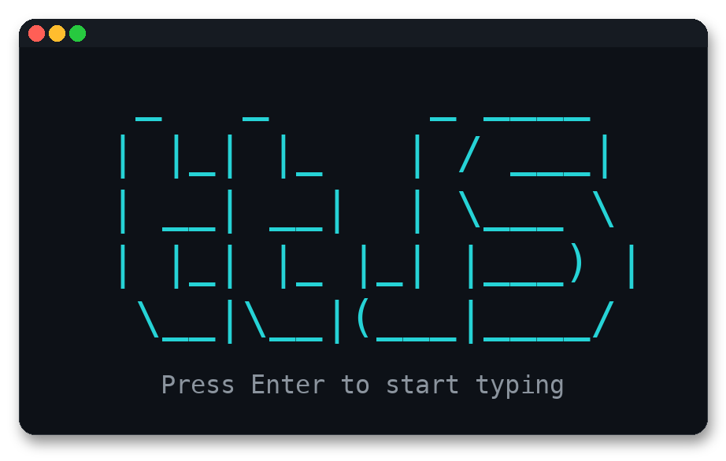

<p align="center">
  
</p>

<h1 align="center">Terminal Typing Test (ttjs)</h1>

A terminal typing trainer with a timed Monkeytype-style test and a spaceship word-blaster game. Both modes use the same English word list.

## Features

- Splash menu to pick a mode
- Timed typing tests (Monkeytype-style)
- Spaceship typing game (type words to blast them)
- Configurable timed-test duration via CLI (`--time` / `-t`)
- Real-time color-coded typing feedback
- Words Per Minute (WPM) calculation for timed tests
- Clean terminal interface
- Help menu (`--help`, or `?` in the app)

## Installation

No dependencies required! Just make sure you have Node.js installed (v14 or higher).

## Usage

Open the splash menu:

```bash
npm start
```

or

```bash
node index.js
```

Start a custom-length timed test directly:

```bash
node index.js --time 30
```

or

```bash
node index.js -t 60
```

Start the spaceship game directly:

```bash
node index.js --game
```

or

```bash
node index.js -g
```

Show help:

```bash
node index.js --help
```

## Splash Menu

The title splash is the mode menu:

- **1** or **Enter** — Timed typing test
- **2** — Spaceship typing game
- **?** — Help
- **ESC** / **q** — Quit

## Timed Typing Test

1. Pick mode **1** from the splash menu
2. A paragraph of random words appears (three wrapped lines)
3. Start typing — the timer begins on your first keypress
4. Color feedback:
   - **Green** = correctly typed
   - **Red** = incorrectly typed
   - **Gray** = not yet typed
5. Finished lines stay visible; completing the paragraph swaps in a new one immediately
6. When the timer hits zero, results show WPM, accuracy, and duration
7. Press **Enter** to retry, **m** for the menu, **?** for help, or **q** to exit

### Timed-test scoring

`(correct characters / 5) / (configured seconds / 60)`

## Spaceship Typing Game

1. Pick mode **2** from the splash menu
2. A ship sits on the left; words drift in from the right
3. Type a word to lock onto it — progress is colored like the timed test
4. Finish the word and the ship fires a laser; the word explodes
5. If a word reaches the ship, the game ends
6. Press **Enter** to retry, **m** for the menu, or **q** to exit

## Controls

- **1 / Enter** (splash) — Timed typing test
- **2** (splash) — Spaceship game
- **?** — Help
- **ESC** — Quit (or return from help)
- **Backspace** — Delete / undo
- **m** (results) — Return to splash menu
- **q** (splash or results) — Quit
- **Ctrl+C** — Quit

## Example: Timed Test

```
                    ╔══════════════════════════════════════════════════════════╗
                    ║            TYPING TEST - Type the text below             ║
                    ╚══════════════════════════════════════════════════════════╝

                    Text to type:
                    ────────────────────────────────────────────────────────────

                    will it house say with nation go by might many still the
                    long then than so house very many other person in take like
                    day what hand such seem but hold another here or nation up

                    ────────────────────────────────────────────────────────────

                    Time left: 12.4s / 15s
                    Characters: 18
                    Accuracy: 100.0%

                    ────────────────────────────────────────────────────────────
                    Press ESC to quit, Backspace to delete
```

## License

MIT
